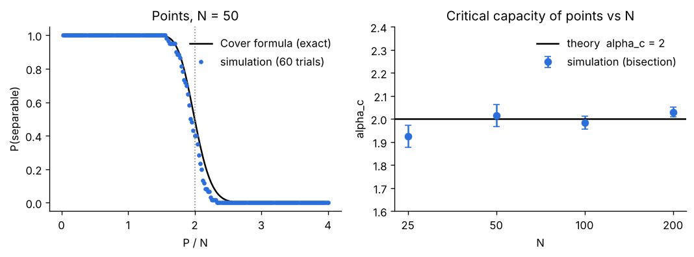
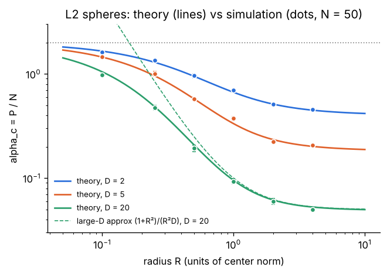
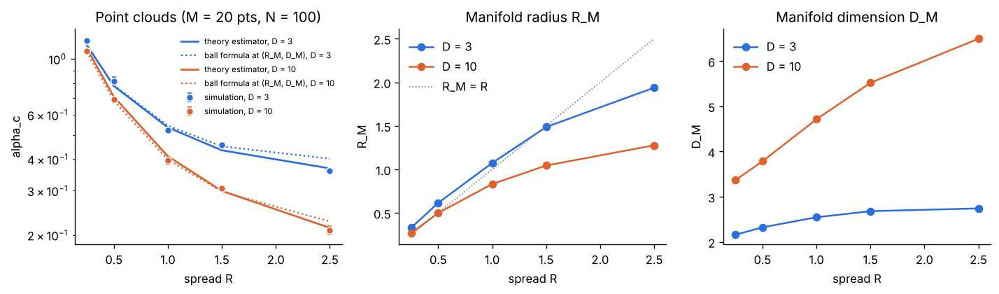
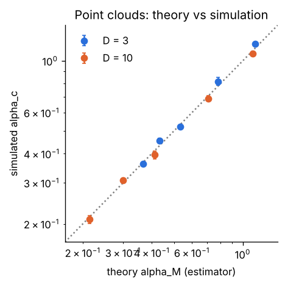
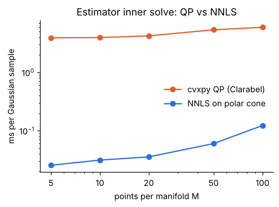
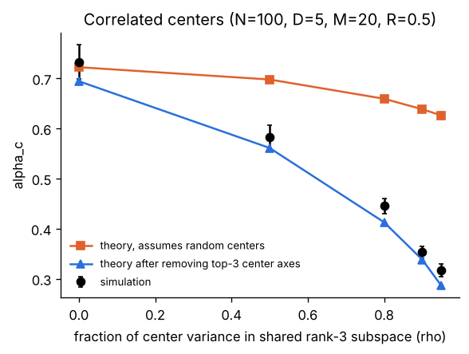
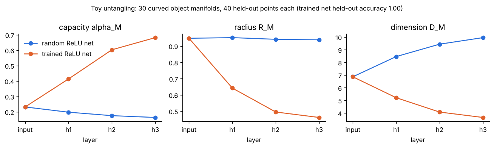

# Manifold capacity: a from-scratch reproduction

Reproduction and small extension of

- S. Chung, D. D. Lee, H. Sompolinsky (2018). *Classification and Geometry of General Perceptual Manifolds.* Physical Review X 8, 031003. arXiv:1710.06487
- U. Cohen, S. Chung, D. D. Lee, H. Sompolinsky (2020). *Separability and geometry of object manifolds in deep neural networks.* Nature Communications 11, 746.

Everything (theory, estimator, simulations) is implemented here with numpy, scipy and cvxpy. No existing manifold-capacity package is used.

## What the paper claims

A linear readout of N neurons has to separate P object manifolds (all the responses to one object under changes in pose, lighting and so on) into two classes with random labels. The largest load alpha_c = P/N at which this is still possible is the **manifold capacity**.

1. For single points, alpha_c = 2 (Cover 1965).
2. For general manifolds, replica mean-field theory gives

   alpha_M^{-1} = E_t [ min over V with V.s >= 0 for all s in the manifold of ||V - t||^2 ],  t ~ N(0, I),

   which is a small quadratic program per Gaussian sample t. The solution picks an **anchor point** on the manifold for each t. The statistics of the anchor points define a manifold radius R_M and dimension D_M.
3. For L2 balls/spheres of radius R and dimension D the theory has a closed-form double integral. At R = 1 it gives exactly alpha = 2/(D+1). At large D it is approximately (1 + R^2) / (R^2 D).
4. A general manifold behaves like an L2 ball with radius R_M and dimension D_M, so capacity is governed by its anchor geometry.

## What was reproduced

| Component | File |
|---|---|
| Sphere/ball capacity formula (three regimes: interior, touching, embedded) | `mcap/theory.py` |
| Cover's exact separability probability | `mcap/theory.py` |
| General point-cloud estimator (alpha_M, R_M, D_M) | `mcap/estimator.py` |
| Simulated capacity by bisection on separability: points (LP), spheres (SOCP), point clouds (LP) | `mcap/simulate.py` |

**How the simulation works.** For each trial, draw P_max manifolds and random +/-1 labels once. Separability of the first P manifolds is monotone in P (a plane that separates P manifolds also separates any subset), so integer bisection on P finds the exact largest separable P* for that draw. I report alpha_c = (mean P* + 0.5)/N, the midpoint between the last separable and first non-separable load. All readouts have no bias term, matching the theory. Points and point clouds use an LP feasibility check (`scipy.optimize.linprog`, HiGHS). Spheres use the exact second-order cone constraint y w.c - R ||U^T w|| >= 1 (cvxpy, Clarabel), so spheres are not approximated by samples.

**How the estimator works.** Each manifold is expressed in an orthonormal basis of its span, with the center direction first. The feasible set {V : S^T V >= 0} is a polyhedral cone. By Moreau's decomposition, the distance from t to that cone equals the norm of the projection of t onto the polar cone {-S lam : lam >= 0}. So the QP becomes a non-negative least squares problem, min over lam >= 0 of ||S lam + t||, and the cost is ||S lam*||^2. The anchor point is S lam / sum(lam), or the point minimizing t.s when t is already inside the cone. R_M is the RMS norm of the anchor's component orthogonal to the center (in units of the center norm). D_M = E[(t_axis . s_hat_axis)^2]. Population capacity is 1 / mean(1/alpha_mu). All of this is at margin kappa = 0.

## Results

### 1. Points (Cover's theorem)



Simulated alpha_c for points: 1.92 +/- 0.05 (N = 25), 2.01 +/- 0.05 (N = 50), 1.98 +/- 0.03 (N = 100), 2.03 +/- 0.02 (N = 200). Theory: 2. The left panel compares the empirical P(separable) at N = 50 (60 draws) with Cover's exact finite-N formula.

### 2. L2 spheres: capacity vs radius for D = 2, 5, 20



Lines are the mean-field formula, dots are SOCP simulations at N = 50 (6 draws per point). Across 18 conditions the mean absolute relative error is 3.7%. Largest mismatches:

- D = 20, R = 4: simulation 0.050 vs theory 0.053 (12% low). Here the critical P is only about 2 or 3 at N = 50, so the estimate is quantized in steps of 1/N = 0.02. This is a finite-size effect, not a theory failure.
- D = 2, R = 1: simulation 0.697 vs exact 2/3 (4.5% high). D = 5, R = 1: 0.373 vs 0.333 (12% high). Simulations at N = 50 tend to sit slightly above theory around R ~ 1. I attribute this to finite N (the sphere axes are random Gaussian vectors, so they are only approximately orthonormal and orthogonal to the centers at N = 50), but I did not confirm it by scaling N.
- The large-D approximation (dashed) matches the full formula for R >= 1 at D = 20 and fails badly for small R, as expected since it needs R sqrt(D) >> 1.

The theory also passes the exact check alpha(R = 1, D) = 2/(D+1) to 1e-6 (unit test).

### 3. Point-cloud manifolds: estimator vs simulation




Each manifold is M = 20 points, Gaussian in a random D-dimensional subspace (D = 3 or 10) around a random center, with RMS spread R. N = 100, 5 draws per point. The estimator is run on one independent sample of 60 manifolds.

- Mean absolute relative error between estimator and simulation over 10 conditions: **3.2%**, worst 4.8%.
- Example: D = 10, R = 1: simulation 0.395 +/- 0.015, estimator 0.411.
- The ball formula evaluated at the estimated (R_M, D_M) also tracks the full estimator closely (dotted lines), which reproduces the paper's claim that R_M and D_M summarize the geometry. It is least accurate at D = 3, R = 2.5 (0.402 vs simulation 0.361).
- D_M is well below the embedding dimension D and grows with R (for D = 10 it goes from 3.4 to 6.5). This matches the paper's point that at small radius only a few directions of the manifold matter for the anchor points.

## Extensions (not in the original papers as presented here)

### Extension (i): 50 to 150 times faster estimator via NNLS



Reformulating the per-sample QP as NNLS on the polar cone (plus a free early exit when t is already inside the cone) gives the same alpha_M as a generic cvxpy QP to about 1e-9, while being 154x faster at M = 5 points per manifold and 48x faster at M = 100 (0.03 ms vs 3.9 ms per sample at M = 5). That makes the estimator cheap enough to run with many Gaussian samples on hundreds of neural manifolds.

### Extension (ii): correlated manifold centers, where the theory breaks



Theory assumes manifold centers are random and uncorrelated. Here a fraction rho of each center's variance lies in a shared rank-3 subspace (N = 100, D = 5, M = 20, R = 0.5).

| rho | simulation | estimator, raw | estimator, top-3 center axes removed |
|---|---|---|---|
| 0.0 | 0.73 | 0.72 | 0.69 |
| 0.5 | 0.58 | 0.70 | 0.56 |
| 0.8 | 0.45 | 0.66 | 0.41 |
| 0.9 | 0.35 | 0.64 | 0.34 |
| 0.95 | 0.32 | 0.63 | 0.29 |

The raw estimator treats each manifold in isolation and overestimates capacity by up to 2x when centers are correlated. Projecting out the top-3 principal axes of the centers before analysis (a simple version of the low-rank center correction of Cohen et al. 2020) brings the estimate back within about 10% of simulation, with a small underestimate at high rho. This matters for real data, where object responses share large common modes (for example running or arousal modulation in mouse visual cortex).

### Extension (iii): toy "untangling" across depth



Input: 30 curved 3-dimensional object manifolds in 200 dimensions (random Fourier features of a latent, radius about 2x the center norm). Two 3-hidden-layer ReLU networks of width 200: one with random He-initialized weights, and one trained (sklearn MLP) to classify the 30 objects. Geometry is measured on 40 held-out points per object.

| layer | random net alpha_M / R_M / D_M | trained net alpha_M / R_M / D_M |
|---|---|---|
| input | 0.23 / 0.95 / 6.9 | 0.23 / 0.95 / 6.9 |
| h1 | 0.20 / 0.95 / 8.5 | 0.41 / 0.64 / 5.2 |
| h2 | 0.18 / 0.94 / 9.4 | 0.60 / 0.50 / 4.1 |
| h3 | 0.16 / 0.94 / 10.0 | 0.68 / 0.46 / 3.6 |

The trained net untangles: capacity triples across depth, driven by shrinking radius and dimension, as Cohen et al. report for deep CNNs. Random ReLU layers do the opposite here. They slightly increase D_M and lower capacity. Caveats: the trained network was trained on exactly these 30 objects (held-out accuracy 1.00), so this is a sanity check of the analysis pipeline rather than evidence about generalization. Capacity values are reported only from the estimator for this toy, not checked by simulation.

## How to run

```bash
pip install -r requirements.txt
python run_all.py          # all figures + results/results.json, about 4.5 min on 2 CPU cores
python run_all.py --quick  # fewer trials, about 2.5 min
python -m pytest -q tests  # 7 tests, about 6 s
```

```python
from mcap.estimator import manifold_analysis
res = manifold_analysis(list_of_N_by_M_arrays, n_t=200)
res["alpha"], res["R"], res["D"]
```

## Caveats

- Everything is at margin kappa = 0. The sphere formula supports kappa > 0, but the estimator and simulations do not.
- Simulations use modest N (50 to 200) and 5 to 60 draws per point. The standard errors in the figures are across draws. Finite-size effects are visible when the critical P is small (high D, large R).
- The R_M and D_M definitions follow the paper's anchor-point definitions, but my handling of the center coordinate (taking the component orthogonal to the center as the "axis" part) is a simplification of the reference code. alpha_M itself does not depend on this choice.
- Spheres that the SOCP solver reports as "optimal_inaccurate" are counted as separable.

## Next step: Allen Brain Observatory Neuropixels

The plan for the real project:

1. Load Visual Coding Neuropixels sessions with the AllenSDK and select well-isolated units in V1 (VISp) and higher areas (VISl, VISrl, VISal, VISpm, VISam), plus LGN and LP as controls.
2. Define a manifold per stimulus identity (for example each natural image, or each grating orientation), with points given by trials (spike counts in a 50 to 250 ms window). Optionally use time bins as the within-manifold variability.
3. Subsample the same number of units per area (for example N = 50 to 100, repeated draws) so that alpha_M is comparable across areas, and z-score or sqrt-transform counts.
4. Remove shared low-rank center structure (extension ii) and regress out running speed and pupil before analysis. Without this, the theory will overestimate capacity.
5. Report alpha_M, R_M and D_M per area against the hierarchy score from Siegle et al. (2021). Check the estimator against simulated capacity (bisection on real dichotomies) for at least one area, exactly as done here.
6. Controls: shuffled trial labels, matched firing rates, and a trial-count sweep, since M (trials per stimulus) is small in these datasets.
